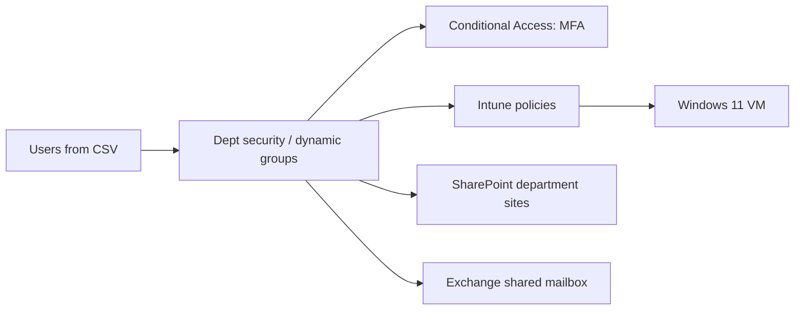

# Architecture & Naming Conventions

## Organization (fictional)

Northern General Hospital Lab — ~24 staff, two locations (Main Campus, North Clinic).

| Department | Staff (initial) | Notes |
|---|---|---|
| Administration | 4 | Executive, HR, registration |
| IT | 4 | Service desk, sysadmin, desktop support |
| Nursing | 7 | Clinical staff, unit clerk |
| Pharmacy | 3 | Shared mailbox for orders |
| Finance | 3 | Payroll / AP |

License budget: the trial includes 25 licenses → 21 initial users + 3 new hires (for onboarding script testing) + 1 reserved for your own daily admin/test account.

## Naming conventions

| Object | Pattern | Example |
|---|---|---|
| User principal name | `<first initial>.<surname>@<tenant>.onmicrosoft.com` | `h.cho@<tenant>.onmicrosoft.com` |
| Security group | `SG-<Dept>` | `SG-Nursing` |
| Dynamic group | `DYN-<Dept>-Users` | `DYN-Pharmacy-Users` |
| Shared mailbox | `<function>@<tenant>...` | `pharmacy-orders@...` |
| SharePoint site | `<Dept> Team Site` | `Finance Team Site` |
| Intune compliance policy | `CMP-Win11-Baseline` | |
| Intune config profile | `CFG-Win11-<purpose>` | `CFG-Win11-Security` |
| Conditional Access | `CA<nnn>-<scope>-<requirement>` | `CA001-AllUsers-RequireMFA` |
| Device | `NGH-<Dept>-<seq>` | `NGH-NURS-001` |

## Admin model

- **Daily admin account** — least privilege roles only (e.g. User Administrator, Intune Administrator), MFA enforced.
- **Break-glass account** — cloud-only Global Administrator, very long random password stored offline, excluded from Conditional Access, sign-in alerts recommended. Used only if normal admin access fails.
- Nobody uses Global Administrator for daily work.

## Diagram

_TODO: add a diagram (draw.io export or Mermaid) showing users → groups → policies → devices._

## Design decisions (fill in as you go)

| Decision | Options considered | Choice | Why |
|---|---|---|---|
| MFA method | Security Defaults vs Conditional Access | _TODO_ | _TODO_ |
| Group type | Assigned vs dynamic | _TODO_ | _TODO_ |
| Device join type | Entra join / registered / hybrid | _TODO_ | _TODO_ |
